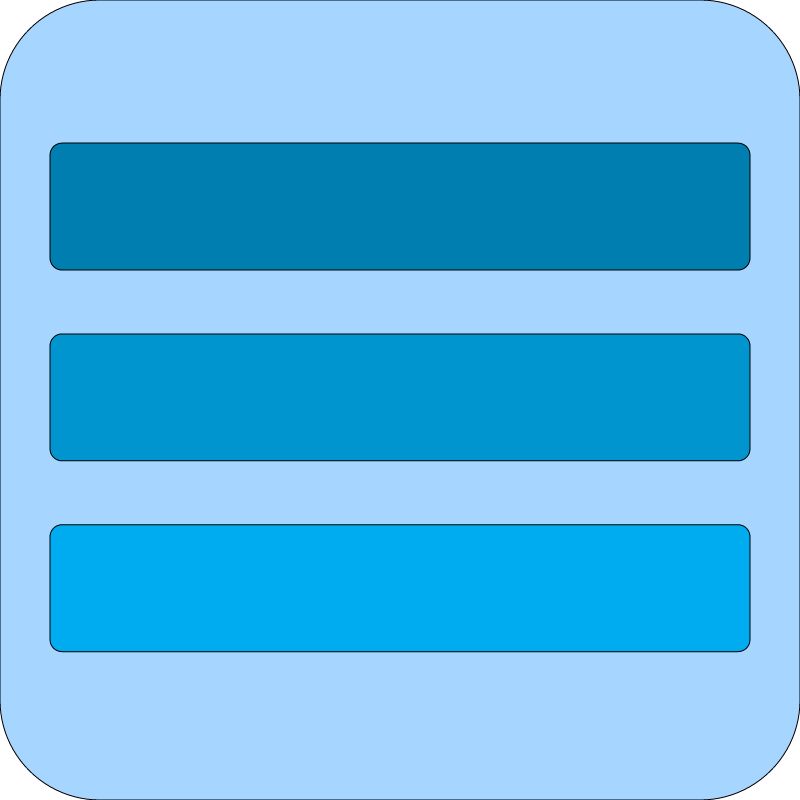

<div align="center">
  
  <h1 align="center">Hyprmenu</h1>
  <p align="center">A .desktop file editor inspired by <i>KMenuEdit</i>.</p>
</div>

## Requirements
- Python
- [CurlFolder](https://github.com/MeltingReactor/curlFolder/)

## Installation
Either run the [installer](https://github.com/LlamaStudiosOfficial/hyprmenu/releases/latest) or run the command below:
```bash
mkdir -p ~/.local/share/applications && curlFolder -q https://githubusercontent.com -o .hyprmenu && curlFolder -q 'https://github.com' -o .hyprmenu && printf '[Desktop Entry]\nType=Application\nName=Hyprmenu\nGenericName=Hyprland .desktop editor.\nIcon=%s/.hyprmenu/hyprmenu.png\nExec=python3 %s/.hyprmenu/hyprmenu.py\n' "$HOME" "$HOME" > ~/.local/share/applications/Hyprmenu.desktop && echo "Done!"
```

Made with [Opencode](https://opencode.ai)
